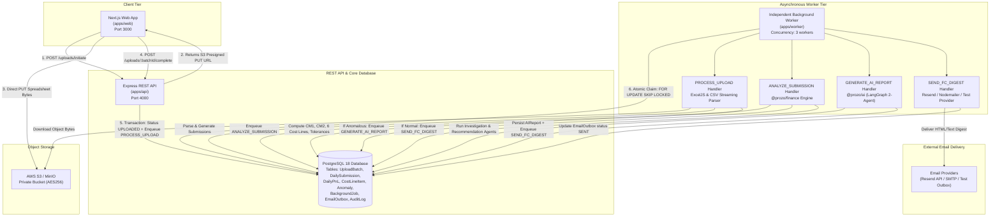

# Prozo Fulfilment Centre (FC) Margin Monitoring System

An end-to-end, multi-tenant Fulfilment Centre (FC) Daily Margin Monitoring platform designed for Prozo operations and finance teams. The platform automates daily ingestion of operational and financial spreadsheets, performs deterministic Contribution Margin (CM1 & CM2) analysis, detects anomalous cost overruns against configurable target rules, triggers an autonomous 2-Agent LangGraph AI investigation workflow, and delivers daily email digests with full audit logging and manager feedback loops.

---

## 1. Problem Statement & Business Objective

Prozo manages multiple distributed Fulfilment Centres across India (`FC-DEL-01`, `FC-BLR-01`, `FC-MUM-01`, `FC-HYD-01`, `FC-KOL-01`, etc.). Operating margins fluctuate daily due to shifting labor productivity, surge overtime, packaging material spikes, dynamic electricity tariffs, and facility overheads. 

### Key Challenges
1. **Spreadsheet Chaos & Inconsistent Formats**: Daily operational numbers submitted in varied Excel/CSV structures with human entry errors and missing FC data.
2. **Delayed Anomaly Detection**: Manual review often takes 3–5 days to catch margin slippages, leading to unrecoverable cost leakage.
3. **Black-Box AI Risks**: Generic LLMs hallucinate financial metrics and calculate erroneous percentages.
4. **Queue Overhead & Fragile Brokers**: Managing Redis/BullMQ brokers introduces state synchronization issues, memory loss on broker restarts, and split-brain failures.

### System Solution
- **Deterministic Pure Financial Core**: Contribution Margin 1 (CM1) and Contribution Margin 2 (CM2), cost ratios, and excess variances are computed strictly using high-precision Decimal arithmetic (`packages/finance`). LLMs are strictly forbidden from altering numbers.
- **Pure PostgreSQL Worker Queue**: A zero-external-broker background queue implemented directly in PostgreSQL (`BackgroundJob` table) using raw `SELECT ... FOR UPDATE SKIP LOCKED`, fencing tokens, heartbeats, and exponential backoff retry policies.
- **Constrained 2-Agent AI Workflow**: Built on LangGraph.js, consisting exclusively of an **Investigation Agent** (which examines read-only, FC-scoped historical context) and a **Recommendation Agent** (which formulates prioritized operational remediations).
- **Multi-Tenant Security**: Role-Based Access Control (`ADMIN`, `FINANCE`, `FC_MANAGER`) where FC Managers are strictly isolated to their assigned fulfilment centres.

---

## 2. System Architecture

The project is structured as a TypeScript monorepo managed with `pnpm`, with separate runtime deployment targets:



### Monorepo Structure

```
FC-data-process/
├── apps/
│   ├── api/          # Express REST API (Auth, Uploads, Dashboard, FCs, Targets)
│   ├── web/          # Next.js 15 App Router Dashboard with Tailwind CSS
│   └── worker/       # PostgreSQL-backed Background Job Processor Runtime
├── packages/
│   ├── ai/           # LangGraph.js 2-Agent Autonomous Investigation Module
│   ├── finance/      # Pure Deterministic Finance Engine, Parsers, Target Resolvers
│   └── shared/       # Zod Schemas, Domain Enums, TypeScript Types, Decimal utilities
├── prisma/
│   ├── schema.prisma # PostgreSQL Data Model & Constraints
│   ├── seed.ts       # Idempotent Seeding Script
│   └── migrations/   # Declarative SQL Migrations
├── tests/
│   ├── unit/         # Deterministic Math, Parser, & AI Graph Unit Tests
│   └── integration/  # Concurrency, Auth, and 5-FC End-to-End Pipeline Tests
└── docker-compose.yml# Local PostgreSQL and MinIO container definitions
```

---

## 3. Financial Logic & Business Rules

All formulas and thresholds are strictly codified in `packages/finance/src/calculations/pnl.ts`:

### Core Margin Formulas
- $\text{Total Direct Costs} = \text{Manpower} + \text{Packaging} + \text{Power \& Electricity}$
- $\text{Contribution Margin 1 (CM1)} = \text{Revenue} - \text{Total Direct Costs}$
- $\text{CM1 \%} = \frac{\text{CM1}}{\text{Revenue}} \times 100$
- $\text{Total Operating Costs} = \text{Total Direct Costs} + \text{Rent} + \text{Equipment / Asset Costs} + \text{Overheads}$
- $\text{Contribution Margin 2 (CM2)} = \text{Revenue} - \text{Total Operating Costs}$
- $\text{CM2 \%} = \frac{\text{CM2}}{\text{Revenue}} \times 100$

### Target Rule Resolution & Illustrative Defaults
*Note: Because the case study workbook was not supplied in the workspace, targets are maintained dynamically in PostgreSQL (`TargetRule` table) with the following illustrative baseline bounds:*
- **Manpower**: 15.00% – 20.00% of Revenue
- **Packaging**: 8.00% – 12.00% of Revenue
- **Power & Electricity**: 3.00% – 6.00% of Revenue
- **Rent**: 10.00% – 15.00% of Revenue
- **Equipment & Assets**: 2.00% – 5.00% of Revenue
- **Overheads**: 3.00% – 7.00% of Revenue

### Anomaly Tolerance Envelopes
A submission triggers margin anomalies if:
- $\text{CM1 \%} < 62.0000\%$ or $\text{CM1 \%} > 73.0000\%$
- $\text{CM2 \%} < 12.0000\%$ or $\text{CM2 \%} > 33.0000\%$
- Any individual cost line percentage exceeds its configured `TargetRule.maxPct`.

### Fulfilment Centre Colour Classifications
1. **RED (Critical Failure)**: $\text{CM2 \%} < 12.0000\%$. Triggers urgent AI investigation and high-priority red alert email.
2. **YELLOW (Warning)**: $12.0000\% \le \text{CM2 \%} < 15.0000\%$ OR $30.0000\% < \text{CM2 \%} \le 33.0000\%$. Triggers warning digest; runs AI if individual cost line overrun exists.
3. **GREEN (Healthy)**: $15.0000\% \le \text{CM2 \%} \le 30.0000\%$ with zero cost line anomalies. Delivers standard green summary email.
4. **BLUE (Suspicious Outlier)**: $\text{CM2 \%} > 33.0000\%$. Unusually high margin flagged for investigation (often indicating unaccrued invoices, omitted rent/power bills, or data misattribution).
5. **MISSING (Non-Reporting)**: Expected active FC with zero submitted records for the business date.

---

## 4. PostgreSQL Job Queue Architecture (Zero Redis)

Background asynchronous execution is built on the `BackgroundJob` table in PostgreSQL.

### Atomic Claim with `FOR UPDATE SKIP LOCKED`
Workers query for available work using raw SQL execution:

```sql
SELECT id FROM "BackgroundJob"
WHERE "status" = 'PENDING'
  AND "availableAt" <= NOW()
ORDER BY "priority" DESC, "createdAt" ASC
LIMIT 1
FOR UPDATE SKIP LOCKED;
```

When claimed:
- State transitions to `PROCESSING`.
- A random UUID `lockToken` (fencing token) is generated.
- A lease deadline is stamped: `lockedUntil = NOW() + INTERVAL '120 seconds'`.
- The worker maintains lease vitality via periodic `heartbeatAt` extensions every 30 seconds.

### Concurrency & Fault Recovery
1. **Fencing Token Guard**: Any write operation (completing, failing, rescheduling) requires `lockToken = :heldToken`. If a worker loses its lease due to garbage collection or network partition, subsequent mutations are aborted.
2. **Lease Reaper**: A background supervisor scans for `status = 'PROCESSING' AND lockedUntil < NOW()`. Abandoned jobs are automatically reclaimed to `PENDING` (if attempts < maxAttempts) or flagged `FAILED`.
3. **Exponential Backoff**: Failed jobs are rescheduled with $2^{\text{attempt}} \times 2000\text{ms} + \text{jitter}$.

---

## 5. LangGraph 2-Agent AI Workflow

Implemented in `packages/ai/src/graph/index.ts` using LangGraph.js:

```
                  ┌──────────────────────┐
                  │    START WORKFLOW    │
                  └──────────┬───────────┘
                             │
                             ▼
              ┌──────────────────────────────┐
              │     Investigation Agent      │
              │  - Examines P&L & Cost Lines │
              │  - Reads 30-day FC history   │
              │  - Analyzes cost overruns    │
              └──────────────┬───────────────┘
                             │ (Findings & Evidence)
                             ▼
              ┌──────────────────────────────┐
              │    Recommendation Agent      │
              │  - Validates findings        │
              │  - Drafts actionable steps   │
              │  - Estimates recovery Rs     │
              └──────────────┬───────────────┘
                             │
                             ▼
                  ┌──────────────────────┐
                  │   Structured Zod     │
                  │   Validation Gate    │
                  └──────────┬───────────┘
                             │
                             ▼
                  ┌──────────────────────┐
                  │  Persist AIReport to │
                  │  PostgreSQL Database │
                  └──────────────────────┘
```

1. **Investigation Agent**:
   - Inspects the anomalous submission and compares line items against historical 7-day and 30-day rolling averages for that specific FC.
   - Outputs root-cause hypotheses strictly linked to verified numerical evidence.
2. **Recommendation Agent**:
   - Consumes validated investigation findings and drafts operational action items with assignee designations (e.g., Facility Lead, Warehouse Operations, Maintenance Manager).
   - Estimates potential margin recovery amounts in Indian Rupees ($\text{INR}$).
3. **Deterministic Fallback**: If the external LLM provider is unavailable or produces invalid JSON schemas, a deterministic rule-based fallback report is automatically generated, guaranteeing zero job stalls.

---

## 6. End-to-End Upload Modes & Direct S3 Flow

The system supports two distinct ingestion workflows:
1. **Centralized Operations Mode**: Finance controllers upload a single multi-FC master workbook covering all national centres.
2. **Single FC Mode**: Local FC Managers upload daily figures solely for their assigned warehouse (`fcId`).

### Direct Browser-to-S3 Presigned Upload
To ensure server stability and prevent memory exhaustion on large spreadsheets, file bytes are never uploaded through the Express API:
1. Web client calls `POST /api/v1/uploads/initiate`.
2. API validates file size and extension, generates a short-lived S3 Presigned PUT URL, and stores an `UploadBatch` in `INITIATED` status.
3. Web client uploads the binary directly to S3 with `Content-Type` and AES-256 server-side encryption.
4. Web client calls `POST /api/v1/uploads/:batchId/complete`.
5. API performs an S3 `HeadObject` check to verify the uploaded byte size, marks the batch `UPLOADED`, and transactionally enqueues a `PROCESS_UPLOAD` background job.

---

## 7. Local Development Setup

### Prerequisites
- Node.js `v20+` or `v22+` (Developed and verified on Node `v26.5.0`)
- `pnpm` `v10+` or `v12+` (Installed: `pnpm 12.21.0`)
- PostgreSQL `14+` (Local instance or Docker container)

### Step 1: Clone and Configure Environment
Copy `.env.example` to `.env`:
```bash
cp .env.example .env
```

Ensure the following variables are set in `.env`:
```ini
# PostgreSQL Database URL
DATABASE_URL="postgresql://adityaraj@localhost:5432/prozo_margin"

# JWT Authentication Secrets
JWT_ACCESS_SECRET="prozo_super_secure_access_secret_key_2026_at_least_32_chars"
JWT_REFRESH_SECRET="prozo_super_secure_refresh_secret_key_2026_at_least_32_chars"

# S3 / MinIO Configuration
AWS_REGION="ap-south-1"
AWS_S3_BUCKET="prozo-margin-monitor-dev"
AWS_ACCESS_KEY_ID="minioadmin"
AWS_SECRET_ACCESS_KEY="minioadmin"
AWS_S3_ENDPOINT="http://127.0.0.1:9000"
AWS_S3_FORCE_PATH_STYLE="true"

# Email Delivery Configuration
EMAIL_PROVIDER="test" # Options: 'test', 'resend', 'nodemailer'

# LLM Configuration
GEMINI_API_KEY="" # Optional; deterministic fallback active if unset
```

### Step 2: Start Infrastructure (Docker)
If you don't have a local PostgreSQL and MinIO running:
```bash
docker compose up -d
```

### Step 3: Database Migrations & Seeding
Apply Prisma migrations and seed users, FCs, and global target rules:
```bash
pnpm prisma:migrate
pnpm prisma:seed
```

#### Default Seed Credentials:
| Role | Email | Password | Assigned FCs |
| :--- | :--- | :--- | :--- |
| **System Admin** | `admin@prozo.com` | `ProzoAdmin123!` | All FCs + Target Rules Admin |
| **Finance Controller** | `finance@prozo.com` | `ProzoFinance123!` | All National FCs |
| **Delhi FC Manager** | `manager.delhi@prozo.com` | `ProzoDelhi123!` | `FC-DEL-01` |
| **Bangalore FC Manager**| `manager.blr@prozo.com` | `ProzoBlr123!` | `FC-BLR-01` |

---

## 8. Running the Application

You can start each runtime process independently in separate terminal windows:

### Terminal 1: REST API (`apps/api`)
```bash
pnpm dev:api
# Running on http://localhost:4000
# Health check: http://localhost:4000/health/live
```

### Terminal 2: Background Worker (`apps/worker`)
```bash
pnpm dev:worker
# Continuously claims and processes BackgroundJob records via FOR UPDATE SKIP LOCKED
```

### Terminal 3: Web Dashboard (`apps/web`)
```bash
pnpm dev:web
# Running on http://localhost:3000
```

---

## 9. Verification & Test Suite

The test suite includes deterministic mathematical unit tests, parser tests, LangGraph agent tests, worker concurrency integration tests, API authorization security tests, and a 5-FC end-to-end lifecycle test.

### Running All Tests
```bash
pnpm test
```

### Output:
```text
Test Files  6 passed (6)
     Tests  50 passed (50)
  Duration  1.34s
```

### Individual Test Suites:
```bash
# 1. Deterministic Financial Math & Target Envelope Tests (34 tests)
pnpm test:unit

# 2. Worker Concurrency, SKIP LOCKED, & Heartbeat Tests (4 tests)
pnpm test tests/integration/worker-concurrency.test.ts

# 3. RBAC & FC Isolation Security Tests (5 tests)
pnpm test tests/integration/auth-and-api.test.ts

# 4. End-to-End 5-FC Scenario (7 pipeline steps)
pnpm test tests/integration/end-to-end-pipeline.test.ts
```

### Building the Entire Monorepo
To build all applications and shared packages for production:
```bash
pnpm build
```
This builds `@prozo/shared`, `@prozo/finance`, `@prozo/ai`, `@prozo/api`, `@prozo/worker`, and compiles the Next.js production bundle in `@prozo/web`.

---

## 10. Security & Operational Hardening

1. **HttpOnly Cookie Authentication**: JWT access and refresh tokens are stored exclusively in `HttpOnly`, `SameSite=Lax` cookies. Client-side JavaScript has zero access to token strings, eliminating XSS token theft.
2. **FC Scoping & Multi-Tenant Isolation**: Every API endpoint filters FC access in the database query (`where: { id: { in: req.user.assignedFcIds } }`). An FC manager attempting to access another FC's submissions or anomalies receives a `403 Forbidden`.
3. **No Financial Hallucination**: Financial metrics, margin percentages, and excess cost variances are strictly generated by TypeScript/Decimal code. LLMs receive facts as read-only inputs and cannot write or alter P&L records.
4. **Audit Logging**: All operational interventions, target updates, and anomaly review actions are permanently logged in `AuditLog` and `AnomalyReview` tables with timestamps and actor IDs.
5. **Private Object Storage**: Direct S3 access is blocked to the public. Uploads require signed authorization with maximum 15-minute validity.

---

## 11. Future Roadmap

1. **ERP & WMS Direct Ingestion**: Implement automated webhooks from SAP/Navision and LogiNext WMS to ingest billing and volumetric data automatically without daily spreadsheet uploads.
2. **Statistical Forecasting**: Incorporate ARIMA/Prophet time-series forecasting to predict electricity tariff surges and festival overtime spikes before they occur.
3. **Automated Ticketing Dispatch**: Enable bidirectional integration with Jira / ServiceNow to automatically convert approved Recommendation actions into warehouse maintenance tickets.
